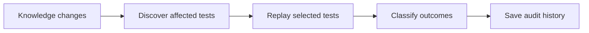
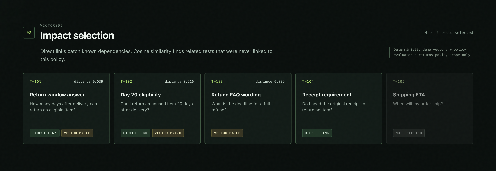
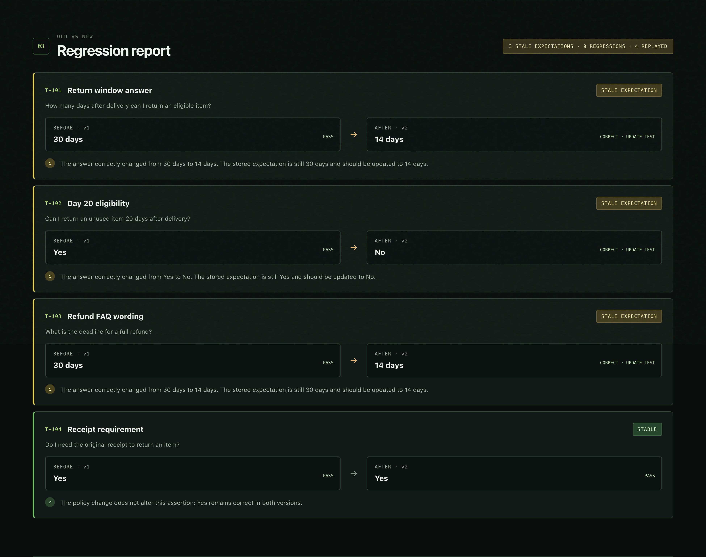
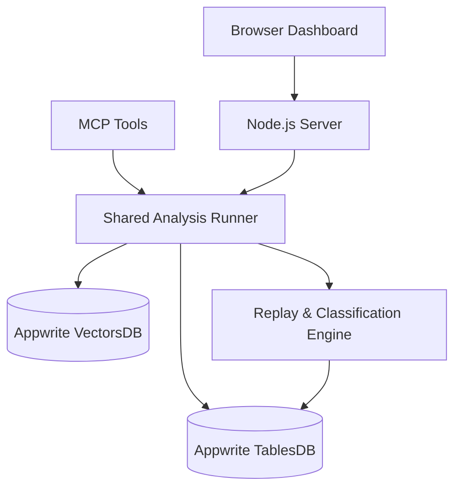

<div align="center">

### Your AI's knowledge changed. What breaks next?

**Find affected tests. Understand changed answers. Keep the evidence.**

[](https://hackathon.appwrite.io/)


[](https://hits.dwyl.com/Omar8345/context-canary)

**Built for the [Appwrite Databases Hackathon 2026](https://hackathon.appwrite.io/)**

</div>

---

## Your knowledge changed. Your tests didn't.

Imagine updating your AI assistant's knowledge base.

Your return policy changes from **30 days to 14 days**. Simple enough, right?

But now:

- Some tests still expect the old 30-day answer.
- Other tests might be affected even though nobody explicitly linked them to the policy.
- A failing test could indicate an actual regression—or simply an outdated expectation.

**How do you know which tests matter, and what their results actually mean?**

That's why I built **Context Canary**.

It helps developers trace the impact of changing AI knowledge, identify affected tests, compare results against old and new context, and preserve an audit trail.

Instead of treating every changed answer as a failure, Context Canary helps explain **what changed, why it matters, and what needs attention**.

## Meet Context Canary

|     | Capability                     | What it does                                                                                 |
| --- | ------------------------------ | -------------------------------------------------------------------------------------------- |
| 🔎  | **Impact discovery**           | Finds affected tests through explicit dependencies and Appwrite VectorsDB similarity search. |
| 🧪  | **Focused regression checks**  | Replays relevant tests against old and new knowledge.                                        |
| 🧠  | **Meaningful classifications** | Distinguishes stale expectations, genuine regressions, and stable assertions.                |
| 📋  | **Persistent audit history**   | Stores completed results in Appwrite TablesDB.                                               |
| 🔌  | **MCP integration**            | Makes analysis and history accessible through tools for MCP-compatible assistants.           |

### From a knowledge change to an actionable result



## See it in action

### 01 — Discover what changed

A returns policy changes from **30 days to 14 days**.

Context Canary combines known dependencies with vector similarity search to discover which tests should be reviewed.



**Four of five tests are selected.**

One of the most interesting results is **T-103, the refund FAQ**. It has no explicit dependency on the policy, yet Appwrite VectorsDB discovers its semantic connection with a cosine distance of approximately `0.039`.

Meanwhile, the unrelated shipping question is correctly excluded.

### 02 — Understand the results

Finding affected tests is only half the problem.

A correct answer can change when the underlying knowledge changes. That doesn't automatically mean the AI has regressed.



The included scenario produces:

| Classification          | Results | Meaning                                                                     |
| ----------------------- | ------: | --------------------------------------------------------------------------- |
| **Stale expectations**  |       3 | The new answer is correct, but the test still expects outdated information. |
| **Genuine regressions** |       0 | No incorrect answers were produced in this run.                             |
| **Stable tests**        |       1 | The assertion remains correct and unchanged.                                |

For example, returning **14 days** under the new policy is correct. A test expecting **30 days** needs updating—not a misleading failure alert.

The engine also supports classifying supplied incorrect answers as genuine regressions, verified through automated tests.

### 03 — Keep the evidence

Every successfully completed connected analysis saves an audit record in **Appwrite TablesDB**.

Each record preserves the selected tests, classifications, counts, and associated run information.

Review past runs directly in the dashboard or retrieve them through MCP.

## Powered by Appwrite

Context Canary uses two Appwrite database services together.

| Appwrite service | Role                                                                                                                                      |
| ---------------- | ----------------------------------------------------------------------------------------------------------------------------------------- |
| **VectorsDB**    | Performs actual cosine similarity searches to discover semantically related tests, including dependencies that weren't explicitly linked. |
| **TablesDB**     | Stores test definitions and persists completed regression reports for later review.                                                       |

The application uses the official **Appwrite Node SDK** for database reads and vector queries. Audit writes retain a direct REST request to support a transport-level timeout.

### Architecture



The dashboard and MCP tools share the same analysis engine, rather than maintaining separate implementations.

## Run locally

### Requirements

- Node.js 20 or newer
- An Appwrite project with TablesDB and VectorsDB available
- An appropriately scoped Appwrite server API key

**1. Clone and install**

```bash
git clone https://github.com/Omar8345/context-canary.git
cd context-canary
npm ci
cp .env.example .env
```

**2. Configure Appwrite**

Add your project credentials to `.env`:

```dotenv
APPWRITE_ENDPOINT=https://your-appwrite-host/v1
APPWRITE_PROJECT_ID=your-project-id
APPWRITE_API_KEY=your-server-api-key
```

Keep `.env` private. It is excluded from version control.

**3. Provision the databases**

For a fresh Appwrite project with the configured resource IDs:

```bash
npm run setup:appwrite
```

This provisions and seeds the required TablesDB and VectorsDB resources.

Skip provisioning if the configured resources already exist.

**4. Launch Context Canary**

```bash
npm start
```

Open **http://127.0.0.1:4173** in your browser.

Once Appwrite is connected, click **Run impact analysis**.

**5. Run automated tests**

```bash
npm test
```

## Built for AI agents, too

Context Canary also includes an optional **Model Context Protocol (MCP)** server.

This allows compatible AI tools to use the same analysis functionality without going through the dashboard.

Start it with:

```bash
npm run mcp
```

Configure your MCP client to launch `node` with the absolute path to `src/mcp.js`. The server loads the project's private `.env`.

### Available MCP tools

| Tool                       | Purpose                                                                               |
| -------------------------- | ------------------------------------------------------------------------------------- |
| `analyze_knowledge_change` | Preview affected tests, similarity results, and classifications without saving a run. |
| `run_regression_checks`    | Run analysis and save an audit record when explicitly authorized.                     |
| `get_audit_history`        | Retrieve recent saved reports from Appwrite TablesDB.                                 |

For example, an MCP client can invoke:

```json
{
  "scenario": "returns-window"
}
```

with `analyze_knowledge_change` to inspect the supported policy-change scenario.

**Safety by design:** Audit writes are disabled by default. They require both `MCP_ALLOW_AUDIT_WRITES=true` and explicit caller confirmation. Preview and history tools remain read-only.

## Under the hood

| Layer                | Technology                                                       |
| -------------------- | ---------------------------------------------------------------- |
| Frontend             | HTML, CSS, JavaScript                                            |
| Backend              | Node.js                                                          |
| Databases            | Appwrite VectorsDB + TablesDB                                    |
| Database integration | Official `node-appwrite` SDK, plus an abortable REST audit write |
| Agent integration    | Official MCP TypeScript SDK, used from JavaScript                |
| Validation           | Zod                                                              |
| Testing              | Node.js automated tests                                          |

### 🥧 Fun fact: Powered by a Raspberry Pi

The Appwrite backend used during development and the live hackathon demo was **self-hosted on a Raspberry Pi 4 with 8 GB RAM**.

Yes, the actual VectorsDB similarity searches and TablesDB audit records ran against Appwrite hosted on a Raspberry Pi—not simulated database responses.

A small computer powering a surprisingly capable developer tool.

## A note on the MVP

Context Canary is a focused hackathon prototype built around **one returns-policy change and five test scenarios**.

Its vectorizer and replay evaluator are deterministic and domain-specific. It does **not** call a live LLM or provide general-purpose embeddings. The live database retrieval and persistence, however, use real Appwrite services.

The dashboard is designed for local use and does not provide production authentication or multi-user isolation.

The goal of this version is to demonstrate a useful idea clearly: **knowledge changes should trigger focused, explainable testing—not a flood of misleading failures.**

---

<div align="center">

### Knowledge changes. Confidence shouldn't disappear.

**Built with Appwrite for the Appwrite Databases Hackathon 2026.**

[GitHub Repository](https://github.com/Omar8345/context-canary) · [Appwrite Hackathon](https://hackathon.appwrite.io/)

</div>
