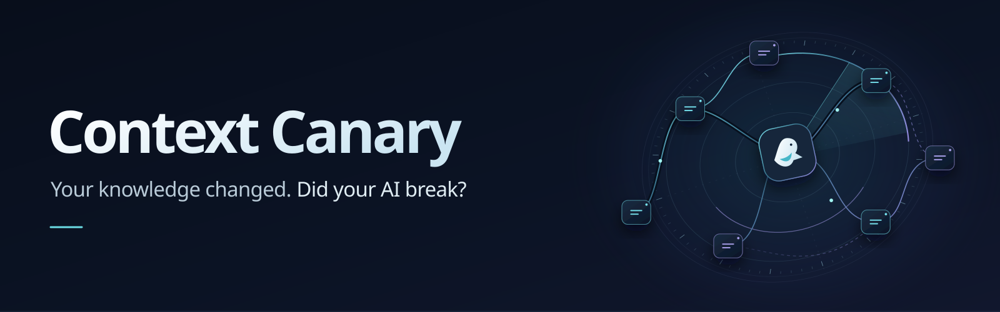
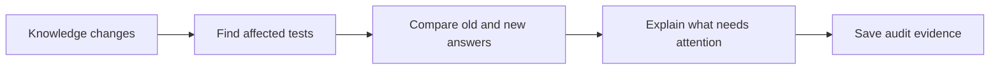
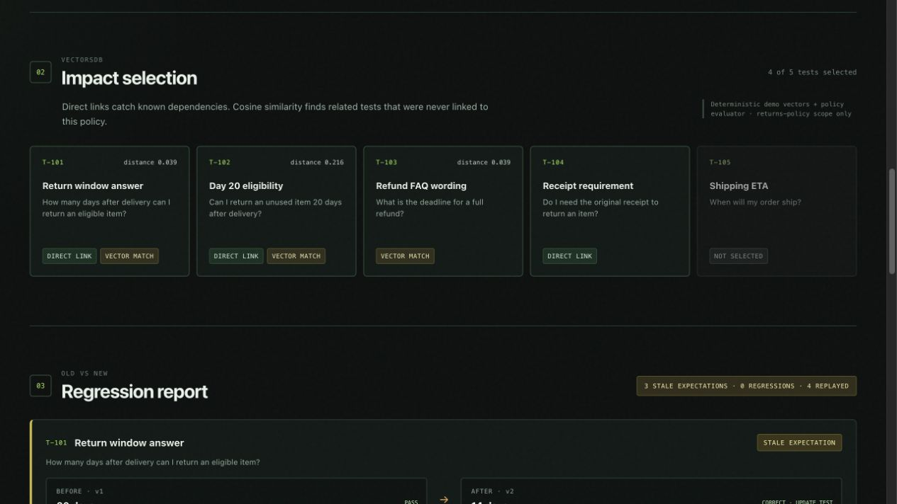
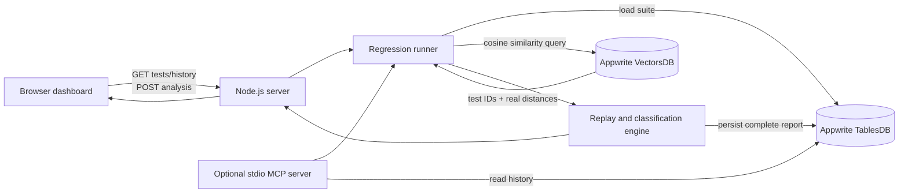

# Catch the impact of changing AI knowledge

**Find affected tests. Understand changed answers. Keep the evidence.**

  

Your knowledge changed. Your test suite didn't.

A policy update can turn yesterday's passing test into today's misleading failure. It can also affect a question nobody thought to link to that policy. Developers need to know where to look—and whether an answer is wrong or a test simply needs updating.

Context Canary turns that investigation into one workflow: find affected tests, compare both context versions, explain the outcome, and keep the evidence. Use the dashboard for a visual walkthrough or the optional MCP server to bring the same analysis into an assistant's tools.

**Try the demo:** a return window changes from **30 days to 14 days**. Four of five tests are selected, including an unlinked refund FAQ. Three expectations need updating, one test stays stable, and an unrelated shipping test stays out of the replay.

> Hackathon MVP: one deterministic returns-policy scenario. Real Appwrite retrieval and persistence; no live LLM or general-purpose embedding model.

[Run locally](#run-locally) · [Architecture](#architecture) · [MCP tools](#optional-mcp-server) · [Limitations](#deliberate-limitations)

## From a changed fact to a focused review



| What you need | What Context Canary does |
| --- | --- |
| Find the tests you might miss | Merges explicit dependencies with real VectorsDB cosine matches. |
| Understand changed answers | Separates stale expectations, incorrect answers, and stable assertions. |
| Keep review evidence | Saves completed connected runs in TablesDB before returning success. |
| Use it from an assistant | Exposes the shared analysis and history through three local MCP tools. |

## See the policy change in action



Captured from a successful live Appwrite run. Distances shown are returned by VectorsDB; this is the deterministic returns-policy demo.

### Read the result correctly

| Classification | Meaning |
| --- | --- |
| `stale_expectation` | The answer is correct for the new context, but the stored test still expects the old fact. |
| `regression` | The answer is incorrect for the new context. |
| `stable` | The assertion remains correct and unchanged across both context versions. |

For the included scenario, the correct result is **3 stale expectations, 0 genuine regressions, and 1 stable test**.

The replay generates answers with a deterministic policy evaluator. It does not call or measure a live AI agent. The engine can classify supplied incorrect answers in automated tests, but the dashboard and MCP demo use the deterministic answers. A correct answer of “14 days” is therefore a stale-expectation finding when the stored test still expects “30 days.”

## Architecture



The server uses the official `node-appwrite` SDK for TablesDB reads, VectorsDB queries, and provisioning. The API key remains server-side and is never sent to the browser. Audit-row creation retains direct REST because the SDK does not expose an `AbortSignal` or transport timeout. This bounds the client request; a server may still commit a write it already received, so cancellation does not guarantee rollback.

### Appwrite schema

**TablesDB database: `context_canary_tables`**

- `canary_tests`: test name, question, legacy expectation, explicit dependency IDs, semantic intent, and deterministic assertion definition.
- `canary_runs`: source, selected-test count, genuine-regression count, policy change, full result JSON, and timestamp.

**VectorsDB database: `context_canary_vectors`**

- `test_intents`: 768-dimensional `embeddings` plus `testId`, name, and intent metadata.
- `embeddings_cosine`: HNSW cosine index used by the live `vectorCosine` query.

## Run locally

### Requirements

- Node.js 20 or newer
- An Appwrite project with TablesDB and VectorsDB available
- A server API key scoped to the project with the database, table/collection, column/index, and row/document read/write permissions required by the setup script

### 1. Configure the server

```bash
git clone https://github.com/Omar8345/context-canary.git
cd context-canary
npm ci
cp .env.example .env
```

Already using a configured checkout? Skip cloning and copying `.env.example`; retain your existing private `.env`.

Fill in:

```dotenv
APPWRITE_ENDPOINT=https://your-appwrite-host/v1
APPWRITE_PROJECT_ID=your-project-id
APPWRITE_API_KEY=your-server-api-key
```

The default resource IDs in `.env.example` match the setup script. Keep `.env` private; it is ignored by Git.

### 2. Provision a fresh Appwrite project

```bash
npm run setup:appwrite
```

This creates and seeds the TablesDB tables, VectorsDB collection, cosine index, test rows, and vector documents. Use it with fresh resource IDs. The application itself does not need setup to be rerun on each start.

### 3. Start the dashboard

```bash
npm start
```

Open [http://127.0.0.1:4173](http://127.0.0.1:4173), confirm the header says **Appwrite connected**, and choose **Run impact analysis**.

### 4. Run the test suite

```bash
npm test
```

The tests cover policy parsing, dependency and semantic selection, classifications, run IDs, adapter orchestration, failure handling, history ordering and limits, and MCP discovery, validation, and write gates. They use deterministic fixtures and mocks; live Appwrite verification is a separate check.

### Troubleshooting

- **Appwrite needs attention:** verify the self-hosted Appwrite services are healthy, the endpoint ends in `/v1`, and the project ID and API-key scopes are correct.
- **Missing resource:** run `npm run setup:appwrite` with fresh resource IDs. The setup command is intended to provision a fresh set of resources, not migrate an existing schema.
- **No vector matches:** confirm the `embeddings_cosine` index is available and that the five vector documents were seeded.
- **Do not expose port 4173 directly:** the built-in server is a loopback-only demo server. Keep it local or place a production-grade authenticated service in front of it.

### Retrieval and history details

Test intents use 768-dimensional vectors and an HNSW cosine index. `VectorsDB.createQuery()` sends `Query.vectorCosine('embeddings', vector)`; returned `$distance` values at or below `0.35` qualify as semantic matches. Explicit dependency links are included regardless of distance. The evaluator then replays the selected tests.

`TablesDB.listRows()` retrieves tests and history. History requests `Query.orderDesc('createdAt')` before `Query.limit(20)`; the dashboard displays six recent rows, while MCP accepts a limit from one to twenty. Stale-expectation counts are derived from the full result JSON saved in each audit row.

## Security and reliability

- The server binds to `127.0.0.1`; it is not exposed publicly by default.
- `.env` and server API keys are excluded from Git and never delivered to the browser.
- Requests carrying an Origin header with a different host are rejected for analysis writes. Requests without Origin are permitted for local clients; this is not authentication.
- Content Security Policy, frame protection, MIME sniffing protection, and restrictive browser permission headers are enabled.
- SDK reads and vector queries have application-level timeouts that stop waiting without cancelling the underlying SDK request; the direct audit write has an abortable transport timeout. All Appwrite failures return sanitized errors instead of server response details.
- Browser-rendered Appwrite text is escaped, dynamic classes are allow-listed, and numeric values are normalized.
- An audit write must succeed before a connected run is returned as successful.

## Deliberate limitations

- The deterministic concept vectorizer is scoped to the returns-policy vocabulary. It demonstrates the VectorsDB retrieval path reproducibly; it is **not** a general-purpose embedding model.
- The replay uses a deterministic policy evaluator, not a live LLM. This isolates dependency selection and result semantics for a reliable hackathon demo.
- The MVP contains one policy change and five tests rather than a production authoring system.
- The dashboard is a local demo and has no authentication or multi-user isolation.
- Test loading uses the default Appwrite page size; this five-test MVP is not a paginated large-suite runner. Stored data is expected to match the seeded schema.
- If saving succeeds but the subsequent history refresh fails, the browser may show a failed operation even though the audit exists. Check history before manually retrying; audit writes are never automatically retried.
- Audit rows produced before the three-state classifier are labeled as legacy alerts in the UI.

## Tech stack

- Node.js with the official `node-appwrite` SDK
- Vanilla HTML, CSS, and JavaScript
- Appwrite TablesDB
- Appwrite VectorsDB through the official server SDK
- One abortable REST call for audit-row persistence, retained because the SDK exposes no request cancellation hook
- Official MCP TypeScript SDK (`@modelcontextprotocol/server`) and Zod schemas, used from JavaScript

## Optional MCP server

Run `npm run mcp` to expose exactly three tools over local stdio using the official TypeScript SDK (`@modelcontextprotocol/server` 2.4.0). The entry point is JavaScript, matching this repository. MCP starts separately and does not change dashboard startup.

Configure your MCP host to launch `node` with the absolute path to `src/mcp.js` as its argument. The server loads the project-root `.env`, regardless of the host's working directory. Keep credentials there rather than in host configuration. stdout is reserved for protocol messages.

Tools:

- `analyze_knowledge_change({"scenario":"returns-window"})`: read-only Appwrite preview with selection reasons, distances, and classifications.
- `run_regression_checks({"scenario":"returns-window","confirmAuditWrite":true})`: same shared analysis, followed by one audit write. Also requires `MCP_ALLOW_AUDIT_WRITES=true` in the server environment or `.env`. Writes are disabled by default.
- `get_audit_history({"limit":10})`: latest summaries from the adapter's bounded 20-row history window; limit must be 1–20.

Only the deterministic 30-to-14-day returns scenario is supported. Tools validate inputs and return structured JSON plus text. Operational failures return `isError: true` with sanitized messages. Audit writes are never automatically retried; after a timeout, inspect history before explicitly trying again because the server may have committed the request. Read-only annotations describe behavior; write authorization is enforced by the server-side opt-in and confirmation argument.

## Hackathon

Built for the [Appwrite Databases Hackathon](https://hackathon.appwrite.io/), October 19–31, 2026.
