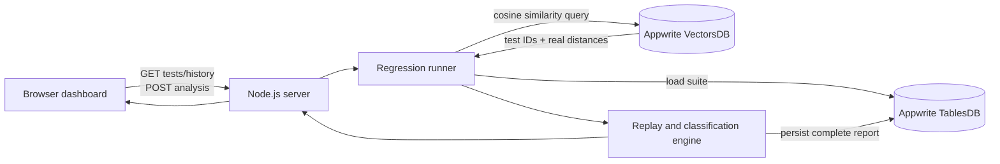

# Context Canary

**Dependency-aware regression testing for changing AI knowledge.**

When a policy changes, teams usually rerun an entire AI test suite—or miss a test whose dependency was never documented. Context Canary combines explicit dependency links with Appwrite VectorsDB similarity search to find the tests most likely to be affected, replay only those tests against the old and new context, classify the outcome, and save an audit record in TablesDB.

The demo follows one concrete change: a returns policy moves from **30 days to 14 days**. Context Canary selects four relevant tests from a five-test suite, including an unlinked refund FAQ found semantically, while excluding an unrelated shipping test.

## What the demo proves

- **VectorsDB performs the impact search.** Test intents are stored as 768-dimensional vectors and queried through an HNSW cosine index. The UI displays the real `$distance` values returned by Appwrite.
- **TablesDB is the system of record.** It stores the structured regression suite and every completed analysis run.
- **The result semantics are honest.** A correct new answer that conflicts with a legacy expectation is classified as a stale expectation—not an agent regression.
- **Failure is explicit.** Vector-query or audit-write failures stop the run and appear in the UI; an unsaved run is never reported as successful.

## Result classifications

| Classification | Meaning |
| --- | --- |
| `stale_expectation` | The answer is correct for the new context, but the stored test still expects the old fact. |
| `regression` | The answer is incorrect for the new context. |
| `stable` | The assertion remains correct and unchanged across both context versions. |

For the included scenario, the correct result is **3 stale expectations, 0 genuine regressions, and 1 stable test**.

## Architecture



The server uses the official `node-appwrite` SDK for TablesDB reads, VectorsDB queries, and provisioning. The API key remains server-side and is never sent to the browser. Audit-row creation retains direct REST because the SDK does not expose an `AbortSignal` or transport timeout. This bounds the client request; a server may still commit a write it already received, so cancellation does not guarantee rollback.

### Appwrite schema

**TablesDB database: `context_canary_tables`**

- `canary_tests`: test name, question, legacy expectation, explicit dependency IDs, semantic intent, and deterministic assertion definition.
- `canary_runs`: source, selected-test count, genuine-regression count, policy change, full result JSON, and timestamp.

**VectorsDB database: `context_canary_vectors`**

- `test_intents`: 768-dimensional `embeddings` plus `testId`, name, and intent metadata.
- `embeddings_cosine`: HNSW cosine index used by the live `vectorCosine` query.

## Run locally

### Requirements

- Node.js 20 or newer
- An Appwrite project with TablesDB and VectorsDB available
- A server API key scoped to the project with the database, table/collection, column/index, and row/document read/write permissions required by the setup script

### 1. Configure the server

```bash
npm ci
cp .env.example .env
```

Fill in:

```dotenv
APPWRITE_ENDPOINT=https://your-appwrite-host/v1
APPWRITE_PROJECT_ID=your-project-id
APPWRITE_API_KEY=your-server-api-key
```

The default resource IDs in `.env.example` match the setup script. Keep `.env` private; it is ignored by Git.

### 2. Provision a fresh Appwrite project

```bash
npm run setup:appwrite
```

This creates and seeds the TablesDB tables, VectorsDB collection, cosine index, test rows, and vector documents. Use it with fresh resource IDs. The application itself does not need setup to be rerun on each start.

### 3. Start the dashboard

```bash
npm start
```

Open [http://127.0.0.1:4173](http://127.0.0.1:4173), confirm the header says **Appwrite connected**, and choose **Run impact analysis**.

### 4. Run the test suite

```bash
npm test
```

The tests cover policy parsing, dependency and semantic selection, stale-expectation semantics, genuine regressions, unique Appwrite-compatible run IDs, live-adapter orchestration, persistence failures, vector-query failures, and safe Appwrite error messages.

### Troubleshooting

- **Appwrite needs attention:** verify the self-hosted Appwrite services are healthy, the endpoint ends in `/v1`, and the project ID and API-key scopes are correct.
- **Missing resource:** run `npm run setup:appwrite` with fresh resource IDs. The setup command is intended to provision a fresh set of resources, not migrate an existing schema.
- **No vector matches:** confirm the `embeddings_cosine` index is available and that the five vector documents were seeded.
- **Do not expose port 4173 directly:** the built-in server is a loopback-only demo server. Keep it local or place a production-grade authenticated service in front of it.

## End-to-end flow

1. The browser requests the test suite and saved history from the local server.
2. The server loads the suite from TablesDB.
3. The changed context is converted into the same deterministic 768-dimensional representation used for stored test intents.
4. VectorsDB runs a cosine similarity query and returns ranked documents with `$distance`.
5. Explicit dependencies and vector matches below the threshold are merged.
6. Only selected tests are replayed against v1 and v2 context.
7. Results are classified as stale expectations, genuine regressions, or stable behavior.
8. The complete run is persisted to TablesDB before the UI reports success.

## Security and reliability

- The server binds to `127.0.0.1`; it is not exposed publicly by default.
- `.env` and server API keys are excluded from Git and never delivered to the browser.
- Cross-origin writes are rejected.
- Content Security Policy, frame protection, MIME sniffing protection, and restrictive browser permission headers are enabled.
- SDK reads and vector queries have application-level timeouts; the direct audit write has an abortable transport timeout. All Appwrite failures return sanitized errors instead of server response details.
- Browser-rendered Appwrite text is escaped, dynamic classes are allow-listed, and numeric values are normalized.
- An audit write must succeed before a connected run is returned as successful.

## Deliberate limitations

- The deterministic concept vectorizer is scoped to the returns-policy vocabulary. It demonstrates the VectorsDB retrieval path reproducibly; it is **not** a general-purpose embedding model.
- The replay uses a deterministic policy evaluator, not a live LLM. This isolates dependency selection and result semantics for a reliable hackathon demo.
- The MVP contains one policy change and five tests rather than a production authoring system.
- The dashboard is a local demo and has no authentication or multi-user isolation.
- Audit rows produced before the three-state classifier are labeled as legacy alerts in the UI.

## Tech stack

- Node.js with the official `node-appwrite` SDK
- Vanilla HTML, CSS, and JavaScript
- Appwrite TablesDB
- Appwrite VectorsDB through the official server SDK
- One abortable REST call for audit-row persistence, retained because the SDK exposes no request cancellation hook

## Optional MCP server

Run `npm run mcp` to expose exactly three tools over local stdio using the official TypeScript SDK (`@modelcontextprotocol/server` 2.4.0). The entry point is JavaScript, matching this repository. MCP starts separately and does not change dashboard startup.

Configure your MCP host to launch `node` with the absolute path to `src/mcp.js` as its argument. The server loads the project-root `.env`, regardless of the host's working directory. Keep credentials there rather than in host configuration. stdout is reserved for protocol messages.

Tools:

- `analyze_knowledge_change({"scenario":"returns-window"})`: read-only Appwrite preview with selection reasons, distances, and classifications.
- `run_regression_checks({"scenario":"returns-window","confirmAuditWrite":true})`: same shared analysis, followed by one audit write. Also requires `MCP_ALLOW_AUDIT_WRITES=true` in the server environment or `.env`. Writes are disabled by default.
- `get_audit_history({"limit":10})`: latest summaries from the adapter's bounded 20-row history window; limit must be 1–20.

Only the deterministic 30-to-14-day returns scenario is supported. Tools validate inputs and return structured JSON plus text. Operational failures return `isError: true` with sanitized messages. Audit writes are never automatically retried; after a timeout, inspect history before explicitly trying again because the server may have committed the request. Read-only annotations describe behavior; write authorization is enforced by the server-side opt-in and confirmation argument.

## Hackathon

Built for the [Appwrite Databases Hackathon](https://hackathon.appwrite.io/), October 19–31, 2026.
